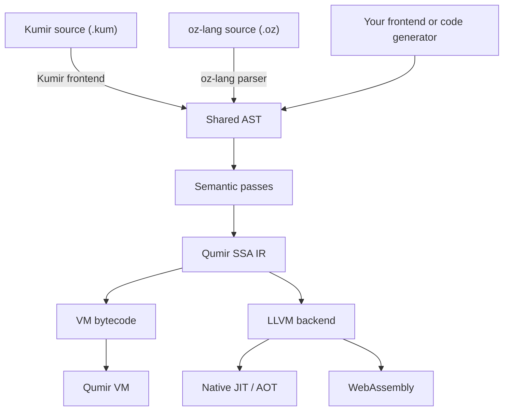
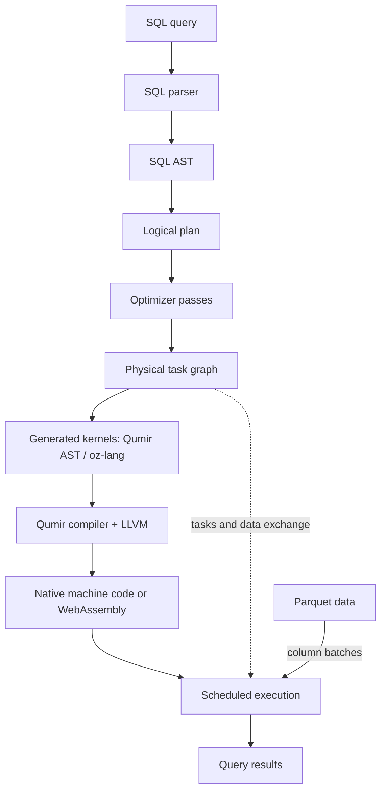

# QumirLabs

We build **Qumir**, a compiler and runtime for implementing programming
languages, and **QumirDB**, an analytical SQL engine built with it.

## Qumir — a compiler foundation for your language

An application may need to run formulas, filters, or processing rules supplied
by its users. A standalone language needs type checking, code generation, and
a runtime. Qumir provides these shared parts so a language implementation can
concentrate on its syntax and meaning.

At its core is **oz-lang**, a typed language that is a textual representation
of Qumir's shared abstract syntax tree (AST), written as **S-expressions**.
It can serve as an intermediate language for other languages and for
generated computations. Applications can generate this text or construct
the same AST directly through the C++ library. Qumir checks and lowers the
AST to its own **SSA intermediate representation (IR)** for optimization
and code generation. oz-lang is also called *core lang* in the documentation.

### Where Kumir fits

**Kumir (КуМир)** is an existing educational programming language with Russian
keywords. **Qumir** is the compiler project: it includes a ready-to-use Kumir
frontend, which translates `.kum` programs into the shared AST. Kumir programs
and oz-lang computations then use the same compiler infrastructure.

This frontend lets students run Kumir programs on their computers or in a
browser. Applications that embed Qumir can use oz-lang or supply another
frontend for their own language.

### Compilation and execution

The bytecode backend executes programs on Qumir's own virtual machine. The
LLVM backend generates native code for execution inside a host application
or as a standalone program, and WebAssembly for browser execution.

The C++ library lets a host application expose its types and functions to
compiled code. A new frontend can generate oz-lang or build the shared AST.
A new backend can consume Qumir IR and reuse the existing frontends and
semantic passes; it must implement the target's instruction lowering and
runtime integration.

[Source](https://github.com/QumirLabs/qumir) ·
[oz-lang guide](https://github.com/QumirLabs/qumir/blob/master/docs/arch/core-lang.md) ·
[Compiler architecture](https://github.com/QumirLabs/qumir/blob/master/docs/arch/overview.md) ·
[Try Kumir in the browser](https://qumir.dev)

## QumirDB — compiled SQL analytics

QumirDB is a **compiled SQL engine for Parquet**. Use SQL to filter datasets,
join tables, and compute aggregates on a computer, on a server, or in a
browser.

Instead of interpreting query expressions during data processing, QumirDB
generates code specialized for each query and compiles it to native machine
code or WebAssembly. Processing column batches is compatible with either
execution model; QumirDB's compilation lets LLVM optimize the query's
expressions and operator computations together.

QumirDB handles SQL parsing, logical planning, optimizer passes, the physical
task graph, and scheduling. It generates computational kernels as Qumir
ASTs, whose S-expression textual representation is oz-lang. Qumir and LLVM
compile those kernels; the scheduler runs tasks that read Parquet batches,
call the compiled kernels, and pass results through the graph.

Custom Rust functions can join the same compilation pipeline. Their LLVM
bitcode is linked with the query code before optimization, allowing a
scientific formula or processing rule to be optimized together with the
SQL that filters or aggregates its results.

[Source](https://github.com/QumirLabs/qumirdb) ·
[Query pipeline](https://github.com/QumirLabs/qumirdb/blob/master/docs/arch/README.md#query-pipeline) ·
[Try SQL in the browser](https://db.qumir.dev)
