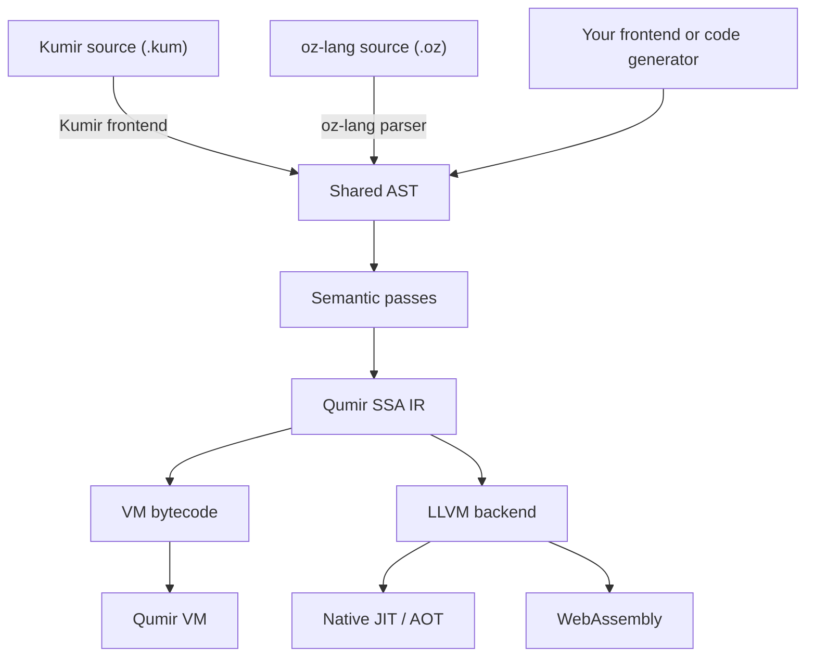

# QumirLabs

We build **Qumir**, a compiler and runtime for implementing programming
languages, and **QumirDB**, an analytical SQL engine built with it.

## Qumir — a compiler foundation for your language

An application may need to run formulas, filters, or processing rules supplied
by its users. A standalone language needs type checking, code generation, and
a runtime. Qumir provides these shared parts so a language implementation can
concentrate on its syntax and meaning.

At its core is **oz-lang**, a typed language that can serve as an intermediate
language for other languages and for generated computations. It has a textual
syntax suitable for generating code, and a corresponding AST that applications
can construct directly through the C++ library. Qumir checks and lowers this
representation to its own **SSA intermediate representation (IR)** for
optimization and code generation. oz-lang is also called *core lang* in the
documentation.

### Where Kumir fits

**Kumir (КуМир)** is an existing educational programming language with Russian
keywords. **Qumir** is the compiler project: it includes a ready-to-use Kumir
frontend, which translates `.kum` programs into the shared AST. Kumir programs
and oz-lang computations then use the same compiler infrastructure.

This frontend lets students run Kumir programs on their computers or in a
browser. Applications that embed Qumir can use oz-lang or supply another
frontend for their own language.

### Compilation and execution

The bytecode backend executes programs on Qumir's own virtual machine. The
LLVM backend generates native code for execution inside a host application
or as a standalone program, and WebAssembly for browser execution.

The C++ library lets a host application expose its types and functions to
compiled code. A new frontend can generate oz-lang or build the shared AST.
A new backend can consume Qumir IR and reuse the existing frontends and
semantic passes; it must implement the target's instruction lowering and
runtime integration.

[Source](https://github.com/QumirLabs/qumir) ·
[oz-lang guide](https://github.com/QumirLabs/qumir/blob/master/docs/arch/core-lang.md) ·
[Compiler architecture](https://github.com/QumirLabs/qumir/blob/master/docs/arch/overview.md) ·
[Try Kumir in the browser](https://qumir.dev)

## QumirDB — SQL analytics built with Qumir

QumirDB runs SQL queries over Parquet files. Its query planner generates
computational kernels using oz-lang and Qumir's compiler pipeline. Those
kernels compile to native code or WebAssembly, allowing query execution on
the desktop, on a server, or in a browser.

For computations beyond built-in SQL functions, QumirDB can compile Rust
functions together with a query. For example, a query can apply a custom
scientific formula to Parquet columns and filter or aggregate its results;
LLVM can optimize the function together with the surrounding query code.

QumirDB is a concrete example of using Qumir as the compilation layer of an
application with its own language, planner, and execution model.

[Source](https://github.com/QumirLabs/qumirdb) ·
[Try SQL in the browser](https://db.qumir.dev)
